# Oosman Saeed — Portfolio

Embedded systems, Linux devices, IoT, edge AI, and desktop software projects.

## Medical Device

Podimetrics' SmartMat+ is a remote foot-temperature monitoring mat for patients at risk of diabetic foot ulcers.

It runs on an STM32H7S7 Cortex-M7, C++ on FreeRTOS. It uses BLE to send data from the footmat to the hub, and the hub uploads data over LTE-M with a Quectel BG95 modem.

I root-caused the upload failures from field logs and bench experiments, reviewed the firmware source, and reduced the upload failure rate from 3% to under 1%.

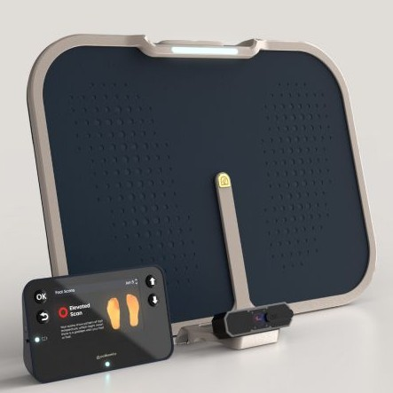

## Time Attendance System

TimeClockPlus tracks the time employees spend at work. It has a badge scanner, RFID, and fingerprint scanner.

I helped upgrade the device that was shipped to 20,000+ customers. I overcame the challenge of upgrading the firmware to modern Qt 6/C++14 without upgrading the ancient Linux kernel 3.0.

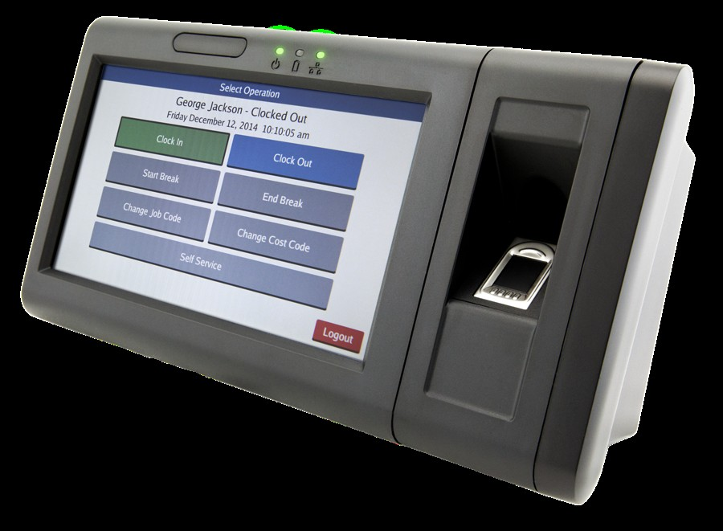

## HVAC Systems

Built an intuitive graphical interface and mobile app that let users control the climate of a building and receive instant notifications. By controlling various relays attached to curtains, fans, and heaters, and reading sensor data from thermostats and humidity sensors around the building, the system had complete control without human intervention and ran 24/7 with no downtime. Coded in C, C++, and Qt.

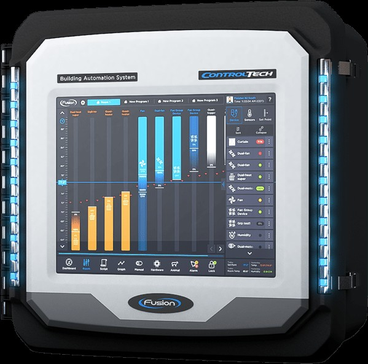

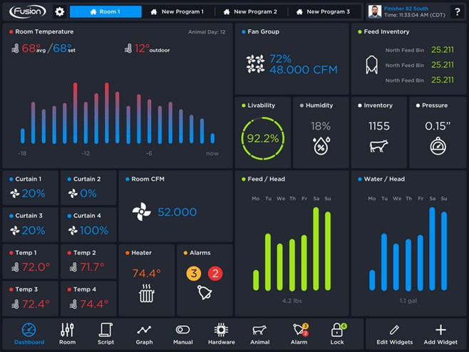

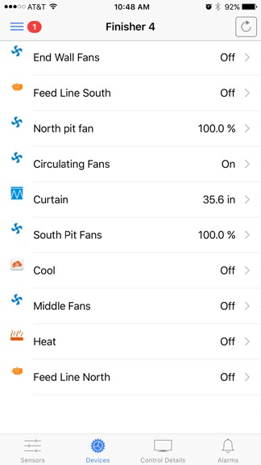

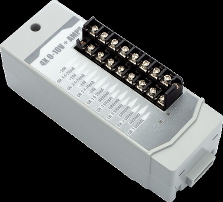

## Smart Thermostat

Built a smart thermostat unit for commercial and residential buildings. Worked on the user interface, OTA secure software updates, and mobile app. Coded in C++ and Qt, and built the Linux distro for the system using Yocto.

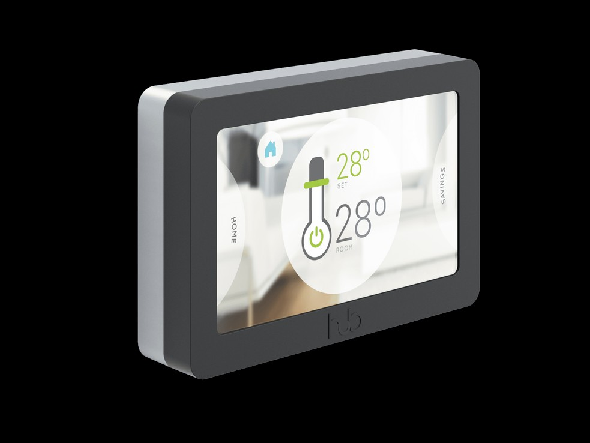

## Smart Door Lock

Built smart locks that can be controlled over BLE and Wi-Fi via a mobile app.

Coded in C++ and Yocto for the Linux distro and OTA software updates.

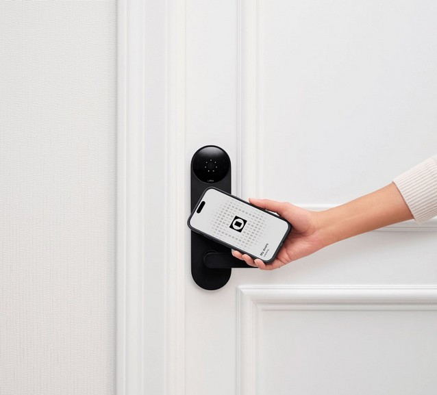

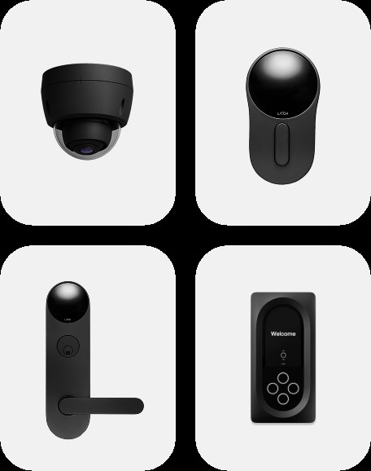

## Steno Typewriter for Court Rooms

Developed a complete Linux distro and C/C++ application logic for this Steno typewriter used in thousands of courtrooms around the world.

Wrote code for interfacing peripheral devices (keyboard via SPI and touchpad via I2C), audio driver for playing and recording audio, LCD driver for displaying the user interface, LVGL code for the user interface, OTA software update, modified device tree files to load Linux drivers and interrupt lines used by SPI and I2C modules, and did board bring-up with Yocto.

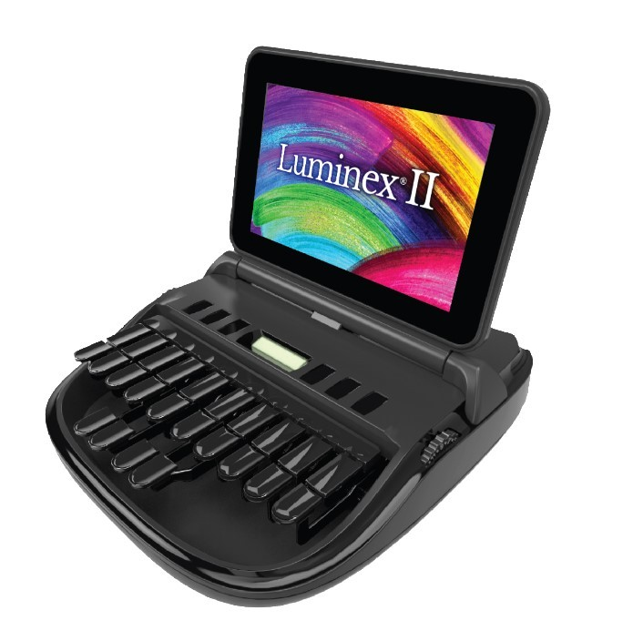

## Aqualab Precision Water Meter

Did the board bring-up for this IoT embedded Linux system using Yocto. Developed OTA software updates and a Python Flask API for retrieving data.

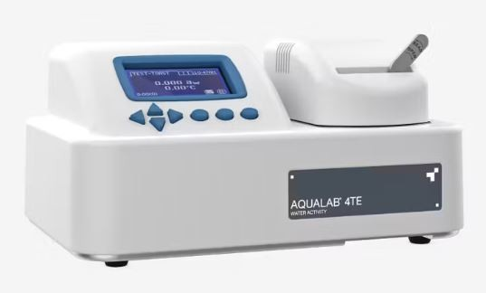

## Autonomous Ag Vehicle Display

Developed a cab-mounted display and controller to help automate farming operations such as planting, spraying, fertilizing, and harvesting using autonomous tractors, combines, sprayers, and harvesters.

Wrote code for auto-steer, auto-drive, interfacing with the engine control unit (ECU), transmission control unit (TCU), and various other sensors and devices on the machine connected via CAN bus and Ethernet.

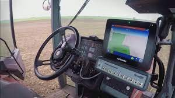

## Machine Sync for Multi-Vehicle Autonomous Farm Operations

Developed a system for running tractors and combines in sync during harvest. As the combine harvests, it processes the grain and shoots it out of the auger into a cart pulled by a separate tractor running alongside. The system I helped develop made this complex multi-vehicle operation autonomous.

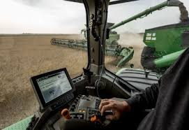

## Precision Sprayer

Developed a system that allowed precision spraying over weeds only, saving the farmer from spraying expensive chemicals over the entire field.

Wrote code for interfacing with cameras mounted on the boom, for image processing, for detecting weeds, and for controlling nozzles to spray over weeds only.

## Augmented Reality Headset (MagicLeap)

Worked on porting the Chrome web browser onto the MagicLeap AR headset. Used the Bazel build system and C++ code.

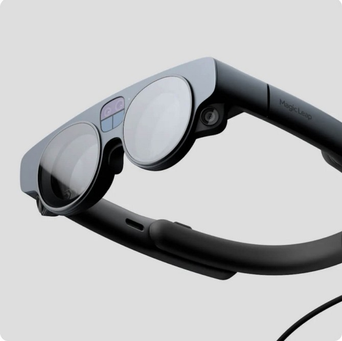

## Screen Recorder

A desktop app written in C++ for Windows and Ubuntu (X and Wayland) that captures your screen and records videos in MP4, Ogg, MKV, or animated GIF formats.

MP4 files are encoded using H.264 (MPEG-4 Part 10, Advanced Video Coding) and AAC (Advanced Audio Codec). Ogg files use Theora video and Vorbis audio codecs. MKV files use VP8 video and Vorbis audio codecs. GIF files are animated forever loops.

The user can capture the entire screen, a rectangular region, or click a window to capture only that window.

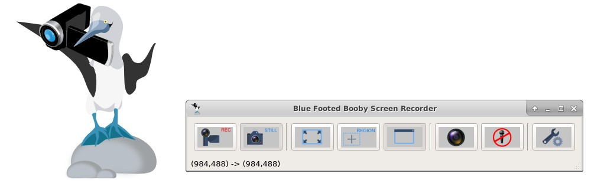

## SquiggleMark — A Video and Image Editing Tool

A desktop app written in C++ for Windows, Ubuntu, and macOS. It lets the user batch edit thousands of media files at the same time. For resizing, rotating, or watermarking many files at once, SquiggleMark is the tool.

It handles video files (MP4, OGG, MKV) in various codecs (H.264, VP8, VP9, Theora, Vorbis) as well as image files (JPEG, PNG, HEIF).

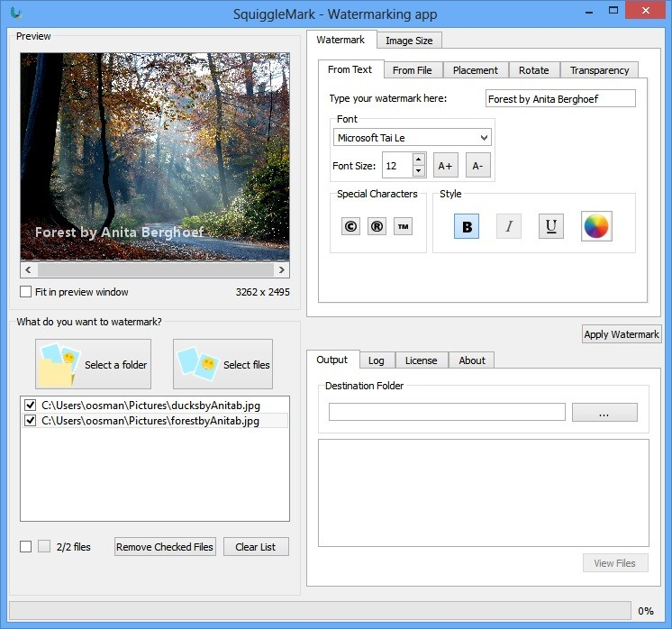

## Kingfisher — Remote Screen Sharing

A desktop app written in C++ for Ubuntu that lets you work on other remote desktops, view their screen, and control their mouse and keyboard.

Uses RTP, RTC, and UDP sockets for streaming video across the network with low latency and fast refresh rate. Uses the H.264 codec for compressing video.

Automatically discovers other machines on your network.

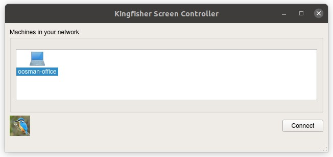

## Smart Bike Helmet

A smart bike helmet that detects nearby cyclists, pedestrians, animals, and cars and warns the user if a collision is imminent.

Built using a Raspberry Pi and Google Edge TPU for AI/ML inferencing. Uses video cameras mounted on the helmet, decodes frames using the H.264 decoder, and detects objects. Then calculates the chance of a collision using current speed and direction read from GPS and an IMU sensor on the helmet.

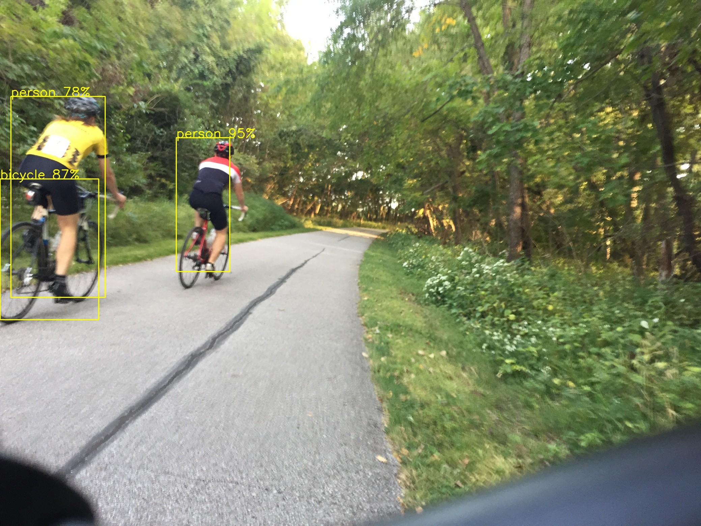

## Remote Task Monitor for Embedded Devices

A desktop application for Windows written in C++ that discovers embedded controllers on your network and lets you control and monitor their CPU and memory usage. It can detect a crashing application on one of those units and alert you.

Uses TCP/IP sockets for communication and UDP messages for automatic discovery when a controller appears on the network.

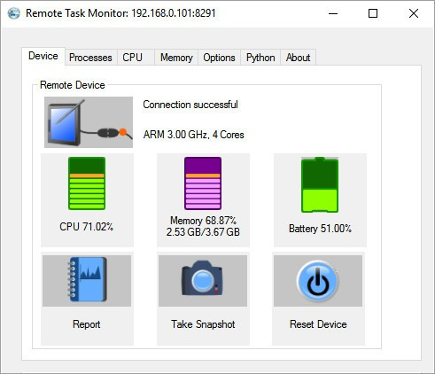

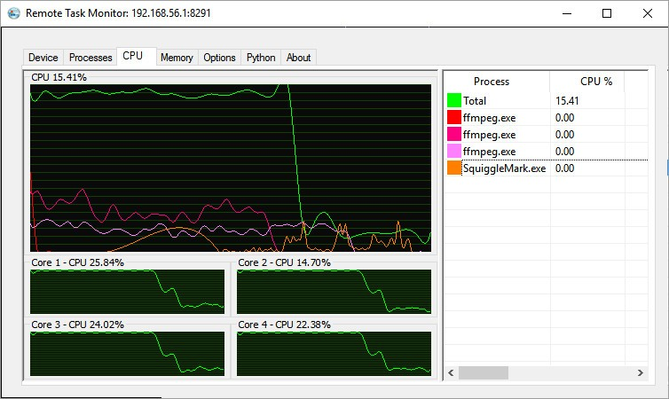

## Mem Reaper — A Memory Leak Detection Tool for Embedded

This is a library that can be loaded by your application. It monitors all memory allocations and de-allocations and keeps track of call stacks each time memory is allocated.

It generates graphs and reports showing what process is leaking memory and what functions in the code are doing it.

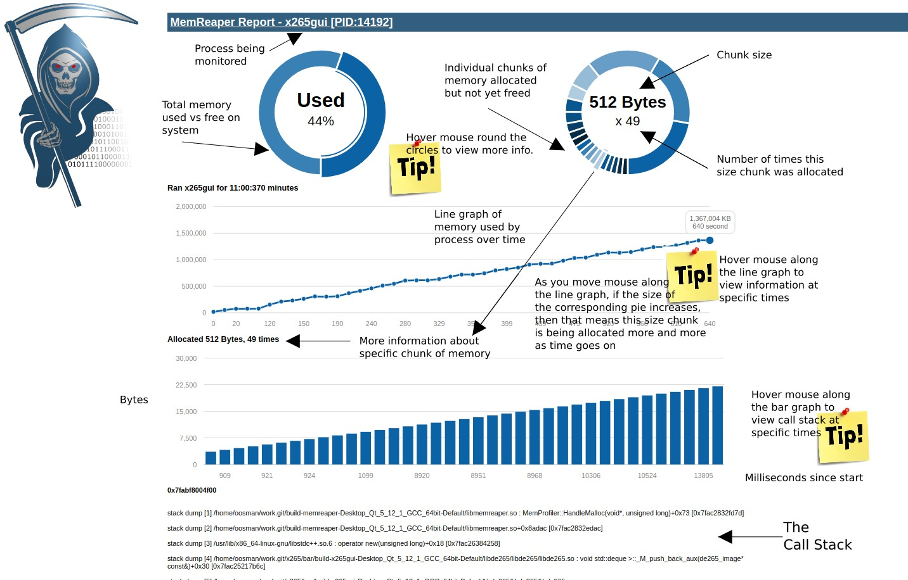

## Website Development

Developed commercial websites using PHP, Node, React, MySQL, PostgreSQL, Redis, Nginx, and Apache.

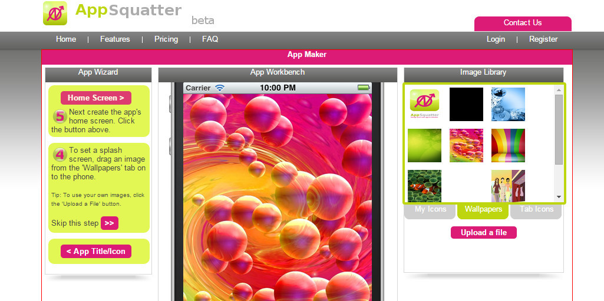

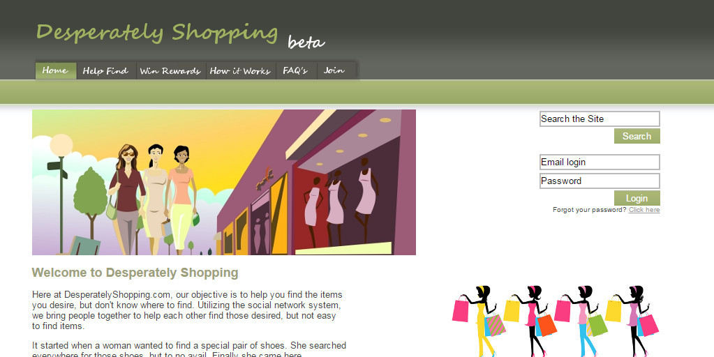

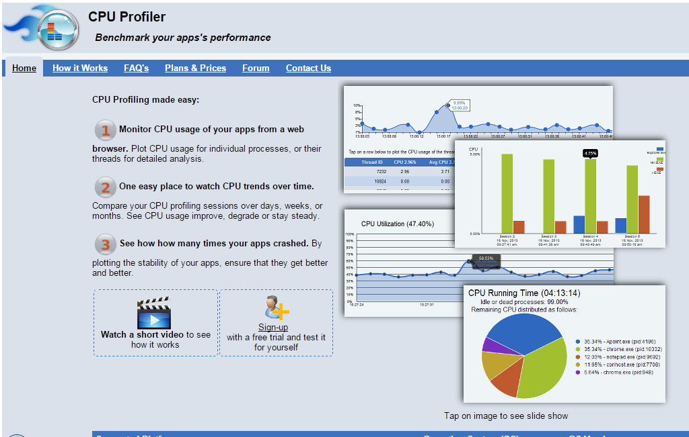
